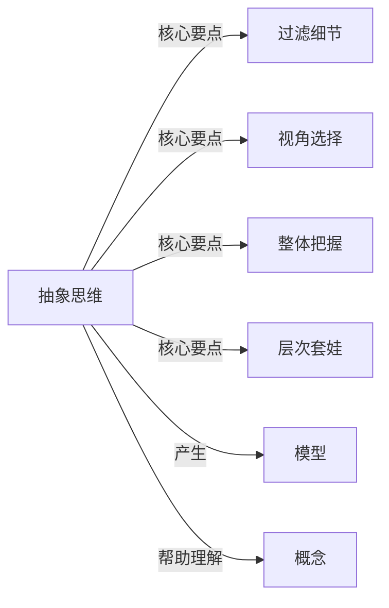

# 抽象思维

## 定义

抽象思维用一句话概括：==忽略细节，从某个角度，从整体上概括一个事情==

## 核心要点

- **过滤细节** — 主动忽略与目标无关的信息
- **视角选择** — 同一事物从不同角度可抽象出不同模型
- **整体把握** — 关注整体结构和关系
- **层次套娃** — 一层抽象之上还能叠一层抽象

## 为什么重要

抽象思维是人类认知的核心能力之一，它使人能够：
- 处理复杂信息，避免被细节淹没
- 把握事物本质，进行高效推理
- 建立通用模型，实现知识迁移
- 在更高层次上创新和解决问题

## 相关概念

- **概括** — 抽象与概括的异同
- **模型** — 抽象的结果形式
- **第一性原理** — 深度抽象的典型应用
- **分类** — 基于抽象的归类思维

## 应用场景

- **学习新知识** — 从具体案例中提炼通用规律
- **解决问题** — 抓住问题本质而非表象
- **编程设计** — 创建可复用的抽象和数据结构
- **沟通表达** — 用简洁抽象的语言传达核心观点

## 关系图

