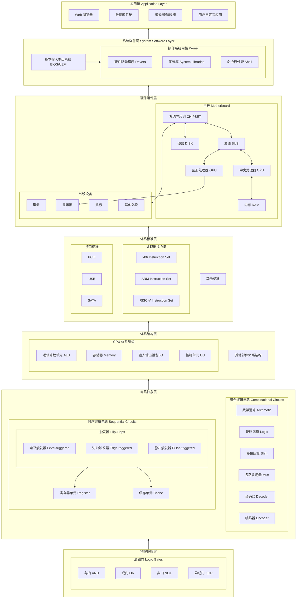
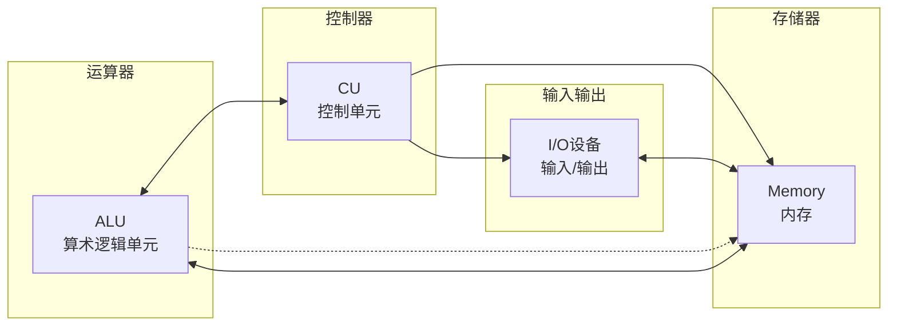
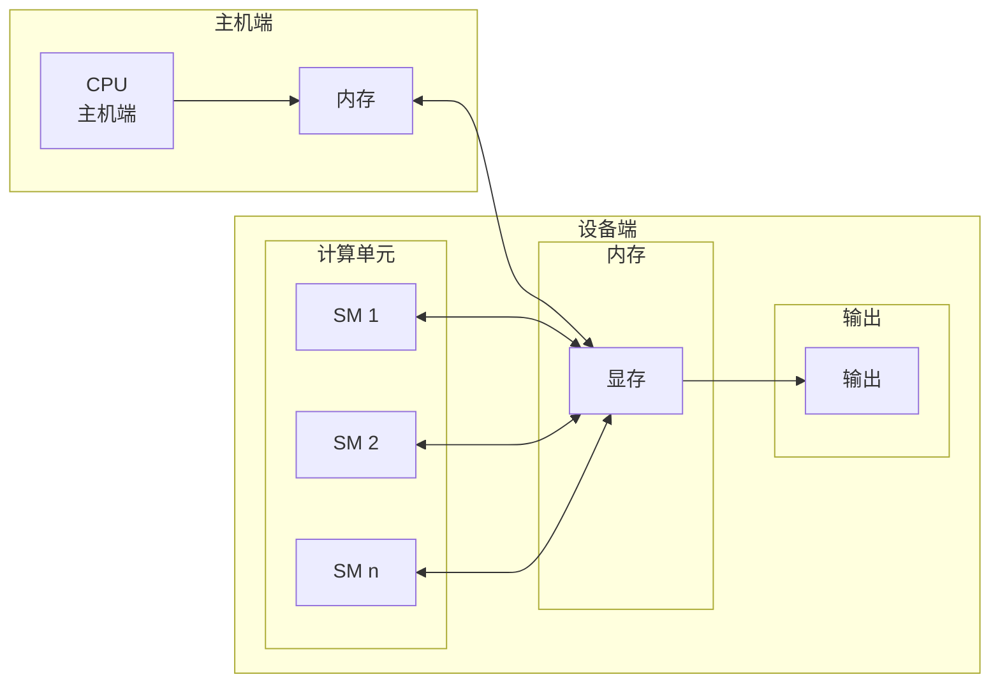
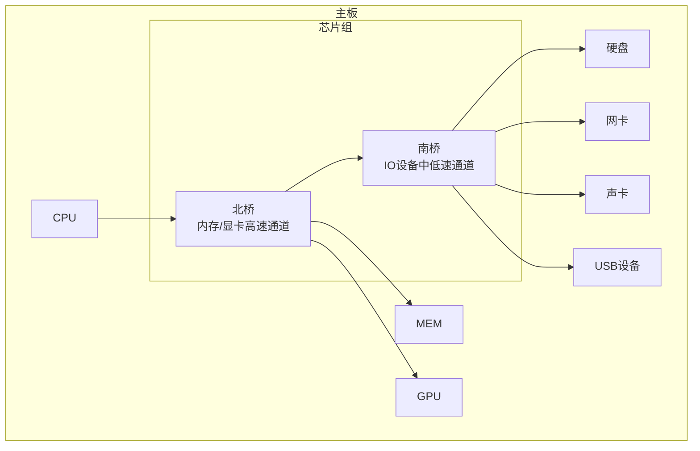

# 计算机体系结构

## 计算机系统层级

| 层级    | 组件                         | 结构抽象    | 功能抽象            | 接口          |
| ----- | -------------------------- | ------- | --------------- | ----------- |
| 物理逻辑层 | 与门、或门、非门、异或门               | 晶体管开关电路 | 布尔运算            | 高低电平信号      |
| 电路抽象层 | 组合逻辑电路、时序逻辑电路              | 逻辑门组合   | 算术运算、逻辑运算、移位、存储 | 多位二进制       |
| 体系结构层 | ALU、存储器、I/O设备、控制单元         | 功能单元集成  | 指令执行、数据存储、输入输出  | 操作数、指令、控制信号 |
| 体系标准层 | 指令集(x86/ARM/RISC-V)、接口标准(PCIe/USB/SATA) | 标准规范集成 | 硬件互联规范、指令兼容 | 指令集架构、设备协议 |
| 硬件组件层 | CPU、GPU、总线、内存、硬盘、键盘、鼠标、显示器 | 部件互联集成  | 运算、存储、通信、人机交互   | 系统总线、设备驱动   |
| 系统软件层 | BIOS/UEFI、操作系统、驱动程序         | 软件栈集成   | 硬件管理、资源分配       | 系统调用、设备文件   |
| 应用层   | 应用程序、浏览器、编译器               | 软件生态集成   | 信息处理、服务提供       | 系统API       |

## 从具体到抽象

| 具体操作        | 抽象概念 |
| ----------- | ---- |
| 加法、减法、乘法、除法 | 运算   |
| 显示、存储、输入、输出 | 数据处理 |
| 读内存、写内存     | 内存访问 |
| 发送数据、接收数据   | 通信   |

## 相关概念

- [[原子/概念-抽象思维]]

## 关系图

### 从盘古开天的抽象

> 我怎么不从宇宙形成说起

### 体系结构模型

#### 冯诺伊曼体系模型

**核心思想：**
- **存储程序**：程序和数据都存储在内存中
- **顺序执行**：指令按顺序执行（除非遇到跳转指令）
- **五大部件**：运算器、控制器、存储器、输入设备、输出设备

#### GPU体系模型

**核心思想：**
- **异构计算**：CPU负责控制调度，GPU负责大规模并行计算
- **SIMT执行**：单指令多线程，一个指令同时在多个线程上执行
- **层次化内存**：全局内存→共享内存→寄存器→本地内存
- **流式处理**：以线程块(Grid/Block/Thread)为单位调度执行

#### 总线体系模型

**核心思想：**
- **总线仲裁**：多个设备共享总线，需要仲裁决定访问权
- **分层总线**：高速总线（CPU-内存/显卡）连接北桥，低速总线（IO设备）连接南桥
- **统一地址空间**：通过总线访问不同设备，像访问内存一样统一编址
- **即插即用**：PCIe等总线支持热插拔，设备可动态加入

## 总结

抽象思维的核心在于：每一层只需要理解下一层提供的**接口**，而无需关心内部实现细节。这种分层抽象的方式，使得数十亿个晶体管组成的复杂计算机系统可以被人类理解、设计和维护。从底层的晶体管到顶层的应用程序，每一层都建立在前一层提供的抽象之上，形成了现代计算机科学的基础范式。
